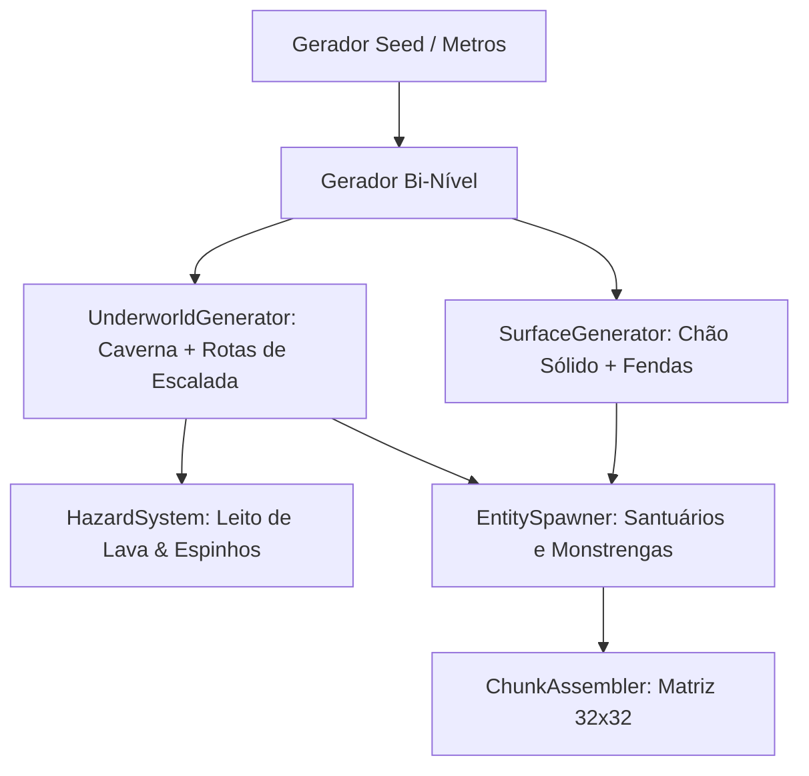

# Especificação de Arquitetura — Gerador Procedural Bi-Nível (Superfície & Subterrâneo)

**Data:** 2026-10-10  
**Status:** Em Revisão (Aguardando Aprovação de Design)  
**Projeto:** Anvil & Magnet (Micro-Metroidvania Roguelite Arcade)  
**Referências:** `sgalban/platformer-gen-2D` (Rhythm-based Generation) e `misterpaul4/Demon-Runner` (Gothic Atmosphere & Distance Escalation)

---

## 1. Visão Geral e Filosofia de Design

A geração de fases adota o modelo **Linear Infinito Horizontal Bi-Nível (Dois Andares)**:
O terreno **NÃO é composto por ilhas flutuantes no vazio**. É um solo sólido e contínuo de pedra e terra firme na superfície, intercalado por **fendas e buracos geológicos**.

### 🌟 Regras Fundamentais de Level Design:
1. **Buraco Nunca Mata por Queda:** Cair em uma fenda da superfície **não causa morte instantânea** nem reinicia a run. O jogador cai no **Andar Subterrâneo (As Catacumbas Inferiores)**.
2. **Rota de Retorno à Superfície:** O subterrâneo possui rotas de escalada — plataformas de apoio, pilares metálicos verticais para atração magnética com a bigorna e rampas — permitindo que o jogador lute para subir de volta à superfície ensolarada/noturna.
3. **Condição Real de Morte (Lava & Espinhos):**
   - A morte por ambiente só ocorre ao cair em **Lava Vulcânica Incandescente** ou em **Poços de Espinhos de Ferro** situados no leito mais profundo do subterrâneo.
   - A queda em si é uma transição de gameplay (tensão e oportunidade), e não uma punição injusta de fim de jogo.

---

## 2. A Estrutura Espacial dos Dois Andares (Corte Vertical)

Cada chunk de mundo possui uma altura vertical expandida (~800 a 900px), dividida em duas camadas contínuas:

```
┌──────────────────────────────────────────────────────────────┐
│  CÉU NOTURNO & PARALLAX                                      │
│                                                              │
│  [ANDAR SUPERIOR - SUPERFÍCIE] (Y ≈ 360 - 440px)             │
│  ███████████████████        ████████████████████████████████ │ <- Solo Firme
│                     \      /                                 │
│                      |    | <- Fenda / Buraco (Entrada)      │
│                      v    v                                  │
│  [ANDAR INFERIOR - SUBTERRÂNEO] (Y ≈ 560 - 750px)            │
│  ░░░░░░░░░░░░░░░░░░░░░░░░░░░░░░░░░░░░░░░░░░░░░░░░░░░░░░░░░░░░ │ <- Teto Caverna
│     [Plataforma]    [Viga Metal]    [Rampa de Subida ^]      │
│  ██████████       ███████████████     ██████████████████████ │ <- Chão Caverna
│                                                              │
│  [LEITO FATAL - FUNDO ABSOLUTO] (Y > 800px)                  │
│  ▲▲▲▲▲ ESPINHOS ▲▲▲▲▲    ~~~~~~~~ LAVA ~~~~~~~~    ▲▲▲▲▲     │ <- MORTE / DANO
└──────────────────────────────────────────────────────────────┘
```

---

## 3. Dinâmica de Gameplay entre os Níveis

### Andar 1: A Superfície (A Rota Expressa de Alta Pontuação)
* **Ambiente:** Céu aberto com o ciclo de crepúsculo e a transição da **Lua Vermelha**.
* **Ritmo:** Corrida fluida e rápida, visão clara e orbes magnéticos flutuando.
* **Inimigos:** Patrulhas regulares de Monstrengas terrestres e DevilBats no céu.
* **Recompensa:** Maior velocidade de avanço em metros e coleta ágil de orbes de combo.

### Andar 2: O Subterrâneo (A Rota Claustrofóbica de Sobrevivência)
* **Ambiente:** Cavernas góticas com estalactites, vigas de ferro enferrujadas e pouca luz.
* **Ritmo:** Mais lento e tático. O jogador precisa se defender em espaços confinados.
* **Inimigos:** Inimigos sombrios **Dark Enemy (Null)** e morcegos rasteiros.
* **A Escalada de Retorno:**
  1. *Salto Duplo na Bigorna:* Usar a mecânica de colocar a bigorna sob os pés para alcançar plataformas superiores.
  2. *Atração Magnética Vertical:* Disparar a bigorna para o teto e puxar-se em direção à fenda da superfície.
  3. *Rampas e Eixos:* A cada 60 a 90 metros no subterrâneo, há uma abertura natural com degraus em zig-zag que leva de volta ao solo da superfície.

### O Leito Fatal: Lava e Espinhos (Condição Real de Morte)
* Localizados apenas nas fendas mais profundas do subterrâneo.
* **Lava:** Causa dano contínuo instantâneo massivo (50% de HP por segundo) e joga o herói para cima com efeito de queimadura.
* **Espinhos:** Morte imediata ao contato no fundo de fossos mal calculados.

---

## 4. Arquitetura Modular do Gerador Bi-Nível

```
src/
└── generation/
    ├── ChunkManager.js          # Streaming horizontal com viewport vertical dinâmico
    ├── SurfaceGenerator.js      # Gera a linha contínua da superfície com fendas naturais
    ├── UnderworldGenerator.js   # Gera cavernas, rotas de resgate, vigas e plataformas
    ├── HazardSystem.js          # Posiciona poços de Lava e Espinhos no leito inferior
    └── EntitySpawner.js         # Posiciona Santuários, Altares, Monstrengas e Orbes
```



---

## 5. Matriz de Contrato de Assets (Para Criação no Outro Chat)

Esta é a lista exata que você pode levar para o outro chat para gerar os assets dos dois andares:

### A. Superfície e Terreno Sólido (`assets/tiles/surface/`)
*Grid: **32 × 32 px**.*

| Slot | Nome do Arquivo | Função Visual |
| :--- | :--- | :--- |
| **Chão Grama/Pedra** | `tile_surface_top.png` | Superfície firme por onde o herói corre na superfície. |
| **Subsolo da Superfície** | `tile_surface_sub.png` | Terra/pedra logo abaixo da grama (o teto do subterrâneo). |
| **Borda de Fenda Esquerda** | `tile_pit_edge_left.png` | Quina esquerda arredondada onde o chão da superfície abre a fenda. |
| **Borda de Fenda Direita** | `tile_pit_edge_right.png` | Quina direita arredondada da fenda. |

---

### B. Subterrâneo & Rotas de Retorno (`assets/tiles/cavern/`)
*Grid: **32 × 32 px**.*

| Slot | Nome do Arquivo | Função Visual |
| :--- | :--- | :--- |
| **Parede de Caverna** | `tile_cavern_wall.png` | Paredes rochosas escuras do subterrâneo. |
| **Plataforma de Caverna** | `tile_cavern_platform.png` | Plataformas suspensas para pular e subir de volta. |
| **Viga de Ferro Vertical** | `tile_iron_pillar.png` | Vigas magnéticas metálicas usadas para atração com a bigorna e escalada. |
| **Estalactite de Teto** | `deco_stalactite.png` | Detalhe decorativo pendurado no teto da caverna (`32 × 48 px`). |

---

### C. Hazards Mortais (`assets/tiles/hazards/`)
*Grid: **32 × 32 px** (Tileable).*

| Slot | Nome do Arquivo | Função no Jogo |
| :--- | :--- | :--- |
| **Lava Borbulhante** | `tile_lava_strip.png` | Superfície de lava incandescente animada (2 a 4 frames). Causa dano massivo por segundo. |
| **Miolo de Lava** | `tile_lava_deep.png` | Bloco sólido vermelho/laranja para preencher poços fundos de magma. |
| **Espinhos de Aço** | `tile_spikes.png` | Espinhos de ferro forjado apontados para cima. Morte instantânea ao tocar. |

---

### D. Cenário, Céu e Coletáveis
* **Céu Noturno / Lua Vermelha:** `sky_gradient.png` e `moon_blood.png` visíveis apenas no andar superior.
* **Fundo de Caverna Escura:** Parallax sutil de rochas sombrias para o andar inferior.
* **Santuários de Descanso:** Localizados na superfície a cada 150m, e raros altares escondidos no subterrâneo.
* **Inimigos:** Monstrenga (superfície e caverna alta), Dark Enemy (fundo do subterrâneo), DevilBats (superfície na Lua Vermelha).

---

## 6. Próximos Passos

1. Leve a **Seção 5** ao seu outro chat para gerar os tiles de superfície, caverna, lava e espinhos.
2. Quando os arquivos estiverem prontos, implementaremos o gerador bi-nível modular com segurança através de TDD.
