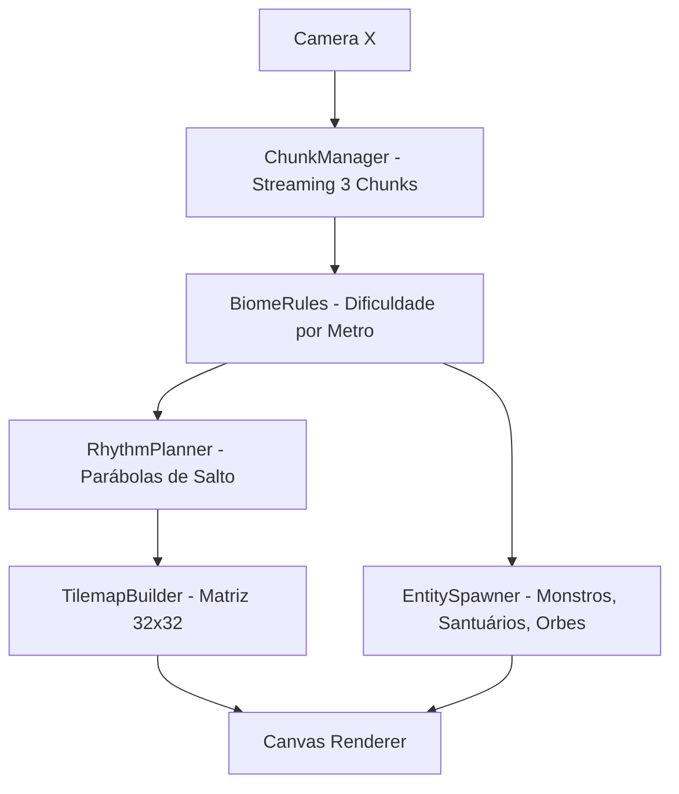

# Especificação de Arquitetura — Gerador Procedural Linear Infinito

**Data:** 2026-10-10  
**Status:** Em Revisão (Aguardando Aprovação de Design)  
**Projeto:** Anvil & Magnet (Micro-Metroidvania Roguelite Arcade)  
**Referências:** `sgalban/platformer-gen-2D` (Rhythm-based Generation) e `misterpaul4/Demon-Runner` (Gothic Atmosphere & Distance Escalation)

---

## 1. Visão Geral e Filosofia de Design

A geração de fases adota o modelo **Linear Infinito Horizontal (Opção A)**.
O jogo inicia no **Templo Central Seguro (X = 0m)** e se expande continuamente para a direita (e opcionalmente para a esquerda em direção às Catacumbas Profundas).

### O Loop Central de Risco vs. Recompensa (Push-Your-Luck):
1. **Cada metro percorrido aumenta a pontuação e o perigo:** A cada 50m, o multiplicador de pontos escala em +0.5x, o terreno ganha mais abismos e a fauna de monstros se torna mais letal.
2. **A Decisão do Teleporte [Q]:** O jogador acumula uma fortuna de pontos conforme avança. Se morrer, perde tudo (Permadeath). Ele deve decidir constantemente: *"Arrisco mais 50m no inferno da Lua Vermelha ou canalizo o teleporte para o Santuário anterior?"*
3. **Travessia Justa Garantida por Matemática (Rhythm Parabola):** Nenhuma plataforma gerada é impossível. A distância e altura dos saltos são calculadas diretamente a partir das constantes de física do Herói ($V_x$, $V_y$, gravidade e alcance magnético da bigorna).

---

## 2. Arquitetura Modular do Sistema

O sistema é composto por 4 módulos autônomos em `src/generation/`:

```
src/
└── generation/
    ├── ChunkManager.js          # Streaming de chunks em memória e reciclagem
    ├── RhythmPlanner.js         # Cálculo das parábolas de salto e cadência de pulo
    ├── BiomeRules.js            # Regras de densidade, inimigos e tiles por metro
    └── EntitySpawner.js         # Posicionamento de Santuários, Orbes, Inimigos e Gás
```



---

## 3. Detalhamento dos Módulos

### 3.1. `ChunkManager.js` (Streaming & Desempenho)
* **Tamanho do Chunk:** $960 \times 540\text{px}$ (30 colunas $\times$ 17 linhas de tiles de $32\text{px}$).
* **Janela Ativa de Memória:** Mantém sempre **3 chunks ativos** simultaneamente:
  - `Chunk Anterior` (saindo pelo lado esquerdo da tela)
  - `Chunk Atual` (centro da câmera)
  - `Chunk Próximo` (sendo gerado à frente do campo de visão)
* **Descarte e Coleta:** Quando o jogador se afasta mais de $1200\text{px}$ de um chunk passado, ele é reciclado na memória (Object Pooling), garantindo consumo de RAM estável (< 40 MB) mesmo após horas de corrida ininterrupta.

---

### 3.2. `RhythmPlanner.js` (Cálculo de Saltos e Parábolas)
Baseado no modelo de Gillian Smith (`platformer-gen-2D`), o planejador define o terreno a partir de **frases de ritmo**:
* **Constantes Físicas do Herói:**
  - Velocidade horizontal: $V_x = 220\text{px/s}$
  - Força de salto: $V_y = -490\text{px/s}$
  - Gravidade: $g = 1050\text{px/s}^2$
  - Tempo de voo do salto máximo: $t = 2 \cdot |V_y| / g \approx 0.93\text{s}$
  - **Alcance Horizontal Máximo sem Bigorna:** $X_{\text{max}} = V_x \cdot t \approx 205\text{px}$ (~6.4 tiles).
  - **Alcance com Salto Duplo de Bigorna:** $X_{\text{max}} \approx 360\text{px}$ (~11 tiles).
* **Regra de Geração:** A largura de qualquer abismo gerado é limitada a no máximo 85% do alcance atual do jogador, garantindo folga para imprecisões no tempo de reação humano.
* **Orbes-Guia de Salto:** Nos saltos de ritmo moderado e alto, um orbe magnético (*Soul Orb*) é colocado exatamente no ápice da parábola ($Y_{\text{pico}}$), fornecendo feedback visual do arco perfeito.

---

### 3.3. `BiomeRules.js` (Escalada de Perigo em 4 Faixas)

| Faixa de Metros | Estado do Céu / Iluminação | Tipo de Plataformas | Inimigos Presentes | Mecânica Chave |
| :--- | :--- | :--- | :--- | :--- |
| **0 a 50m** *(Início)* | Crepúsculo Azul Noturno | Solo de pedra contínuo, degraus de 1 a 2 blocos | Monstrenga (baixa velocidade) | Tutorial de atração/repulsão da bigorna |
| **50 a 120m** *(Catacumbas)* | Noite Escura, Neblina | Abismos de 3 a 5 blocos, vigas de metal magnético | Monstrenga + Null (Dark Enemy) | Escalar plataformas no ar pisando na bigorna |
| **120 a 200m** *(Abismo das Almas)* | Céu Carmesim Sangrando | Plataformas flutuantes estreitas (2 a 3 blocos) | Null ágil + DevilBats em rasante | Arremesso de bigorna para destruir morcegos |
| **200m+** *(Lua Vermelha Extrema)* | Lua Vermelha Eclipse Total | Plataformas magnéticas instáveis, espinhos no fundo | Horda Red Frenzy + DevilBats contínuos | Ativação do Especial "Olha o Gás!" para limpar a tela |

---

### 3.4. `EntitySpawner.js` (Distribuição de Objetos)
* **Santuários de Descanso (Rest Areas):** Gerados a cada $150\text{m} \pm 20\text{m}$.
  - Sempre possuem uma plataforma segura de no mínimo 6 blocos de largura.
  - Nenhum inimigo spawna a menos de $150\text{px}$ do Santuário.
  - Ao passar pelo Santuário, o jogador recupera vida e define o novo ponto de retorno do Recall [Q].
* **Altares da Fortuna:** Gerados uma vez a cada $180\text{m}$ (oferecem modificadores de Sorte ou Revés).
* **Botijões de Gás:** Posicionados em áreas de alta densidade de monstros para incentivar a jogada estratégica de explosão com proteção da bigorna.

---

## 4. Matriz de Contrato de Assets (Para Criação no Outro Chat)

Para o gerador desenhar o mundo perfeitamente no Canvas semântico, os assets devem seguir este mapeamento:

```
assets/
├── tiles/
│   ├── tile_stone_top.png        # 32x32 - Superfície caminhável de pedra
│   ├── tile_stone_mid.png        # 32x32 - Miolo sólido de pedra
│   ├── tile_stone_left.png       # 32x32 - Borda esquerda sobre o abismo
│   ├── tile_stone_right.png      # 32x32 - Borda direita sobre o abismo
│   ├── tile_metal_beam.png       # 32x32 - Viga metálica condutora (magnética)
│   └── tile_spikes.png           # 32x32 - Espinhos mortais no fundo
├── environment/
│   ├── sanctuary_pillar.png      # 48x80 - Pilar sagrado de checkpoint/cura
│   ├── crystal_active.png        # 24x24 - Luz mágica verde/azul do santuário
│   ├── fortune_altar.png         # 48x64 - Altar de Sorte ou Revés
│   └── sky_gradient.png          # 960x540 - Céu noturno dinâmico
├── collectibles/
│   └── soul_orb.png              # 16x16 - Orbe magnético guia de parábolas
└── enemies/
    ├── monstrenga/               # Já integrado (7 frames)
    ├── null/                     # Já integrado (7 frames)
    └── red/                      # Já integrado (7 frames)
```

---

## 5. Próximos Passos (Transição sem Implementação Imediata)

1. Você pode usar a Seção 4 como guia exato no seu outro chat para desenhar e exportar os tiles e cenários.
2. Quando os arquivos estiverem prontos e salvos nas pastas, faremos a integração modular via `writing-plans` e TDD sem quebrar nada do gameplay existente.
